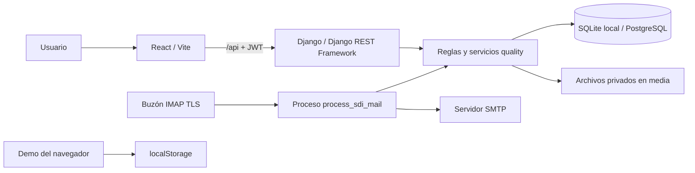
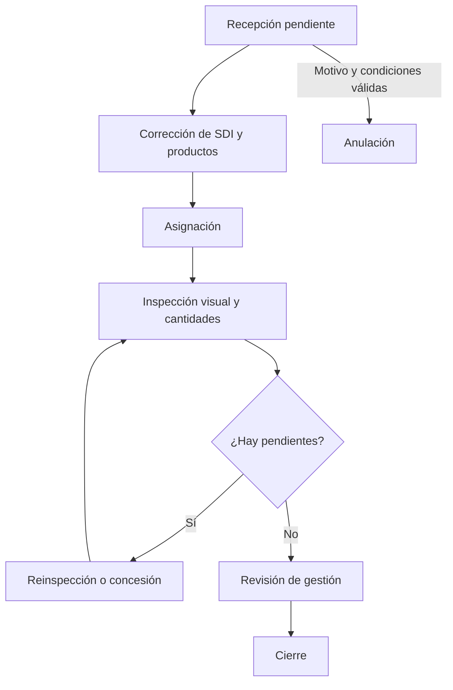

# Arquitectura del sistema

## Componentes y comunicación

En desarrollo Vite reenvía `/api` a `127.0.0.1:8000`. Producción necesita un proxy equivalente bajo el origen del frontend. Los PDF y evidencias se descargan a través de la API autenticada.

## Distribución del código

| Archivo / carpeta | Responsabilidad |
| --- | --- |
| backend/config | Ajustes, rutas principales y entradas WSGI/ASGI |
| quality/models.py y migrations | Entidades, restricciones y evolución del esquema |
| quality/serializers.py | Validación y representación de datos |
| quality/permissions.py | Roles activos y acceso a inspecciones |
| quality/workflow.py | Recepción, asignación, revisión, anulación y archivo |
| quality/services.py | Operaciones de inspección y resolución |
| quality/workflow_api.py y views.py | Endpoints HTTP y acceso a servicios |
| quality/pdf_intake.py | Extracción conservadora de datos del PDF |
| quality/mail.py y management/commands | Recepción IMAP, avisos y usuarios |
| frontend/src/App.jsx | Estado y navegación de la demostración |
| frontend/src/pages/OperationalApp.jsx | Interfaz del circuito conectado |
| frontend/src/api/workflow.js | Cliente autenticado, renovación y descarga |
| frontend/src/components y hooks | Formularios y elementos compartidos |

## Decisiones existentes

La API vuelve a comprobar permisos y reglas; la disponibilidad de botones no otorga autorización. Las acciones críticas usan transacciones y bloqueos de filas donde se implementan. SQLite permite desarrollar sin tocar PostgreSQL; no demuestra el comportamiento de concurrencia de producción.

El frontend conserva la demo en `localStorage` y los tokens conectados en `sessionStorage`. Las contraseñas de acceso no se guardan. La navegación demo se coordina con estado local y no incorpora un enrutador en esta etapa.

Los avisos se registran en base de datos junto al cambio de negocio y se procesan después. La recepción de PDF conserva la propuesta y el original para revisión humana. No se usa un servicio externo de IA para extraer su contenido.

## Recorrido operativo

El diagrama resume la operación; una concesión puede resolver un pendiente sin realizar otra inspección. El archivo es una marca adicional de conservación y no un estado de resultado.

Fuentes: rutas, servicios, configuraciones y componentes citados. El diagrama no acredita una infraestructura ya desplegada.
