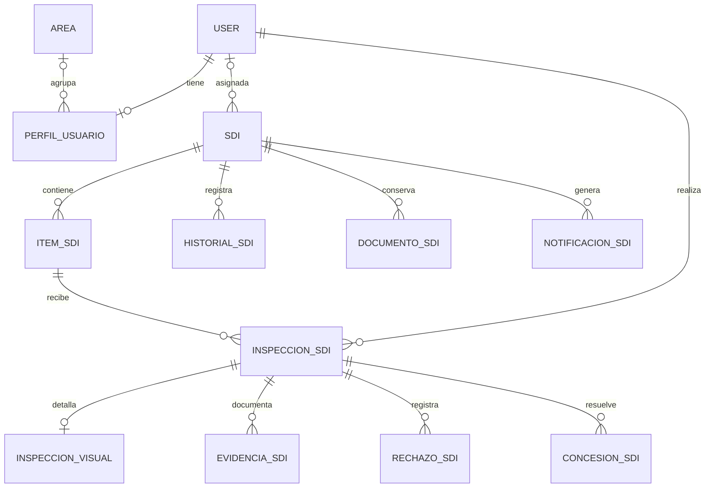

# Modelo y diccionario de datos

Referencia: `backend/quality/models.py` y migraciones `0001` a `0006`. El esquema completo también contiene las tablas propias de Django para usuarios, permisos, sesiones y administración.

## Relaciones principales

`USER` representa el modelo de usuario de Django. Una SDI puede no tener inspector antes de la asignación. Historial también puede referenciar producto, inspección y usuario de forma opcional.

## Diccionario resumido por entidad

| Modelo | Campos principales | Significado |
| --- | --- | --- |
| Area | nombre, descripcion, activo | Catálogo del área del perfil; nombre único |
| PerfilUsuario | usuario, rol, area, activo | Un perfil por usuario; rol administrador/supervisor/jefe_calidad/inspector |
| SDI | prefijo_bod, activacion_proyecto, numero_sdi, fecha_emision | Identificación oficial; puede estar incompleta durante recepción |
| SDI | proyecto, departamento_solicitante, solicitante, correo_origen | Datos de origen; departamento no equivale a área del inspector |
| SDI | inspector, estado, prioridad, observaciones | Asignación y seguimiento |
| SDI | origen, clave_recepcion, datos_pdf, texto_pdf | Procedencia, deduplicación y propuesta extraída |
| SDI | asignada/asignado_por, revisada/revisada_por, comentario_revision | Control de revisión y responsables |
| SDI | fecha_cierre, resultado_cierre, anulada/anulada_por, motivo_anulacion, archivada/archivada_por | Cierre y conservación |
| ItemSDI | sdi, orden, codigo_plano, articulo, descripcion | Producto y secuencia dentro de la SDI |
| ItemSDI | cantidad_indicada, cantidad_a_inspeccionar, unidades_liberadas, resultado_actual | Cantidades originales, alcance y liberación |
| InspeccionSDI | item, numero_inspeccion, inspector | Registro de inspección y responsable |
| InspeccionSDI | cantidad_inspeccionada, cantidad_aprobada, resultado, fecha_inicio, fecha_fin | Cantidades y resolución |
| InspeccionVisual | inspeccion, rebarbas, rayaduras, golpes, deformidad, pintura, burbujas, planitud | Un registro visual por inspección; conforme/no_conforme/no_aplica |
| EvidenciaSDI | inspeccion, tipo, archivo, descripcion, subido_por, fecha | Foto/documento/otro asociado a inspección |
| RechazoSDI | inspeccion, motivo, descripcion, cantidad_afectada, resuelto | Motivo y seguimiento de rechazo |
| ConcesionSDI | inspeccion, decision, responsable_ingenieria, justificacion, documento | Solicitud y resolución de excepción |
| HistorialSDI | sdi, item, inspeccion, usuario, accion, estado_anterior, estado_nuevo, comentario, fecha | Trazabilidad de operaciones |
| DocumentoSDI | sdi, archivo, nombre, sha256, recibido | Original recibido y hash |
| NotificacionSDI | sdi, evento, destinatario, asunto, mensaje, enviada, intentos, error, proximo_intento | Bandeja de salida y reintentos |

Todos estos modelos tienen clave primaria implícita de Django. Varios incorporan fechas de creación/actualización. Para tipos, longitudes, valores por defecto y nullabilidad exactos consulta `models.py`; esta tabla es un diccionario de negocio resumido.

## Restricciones y estados

La combinación prefijo/proyecto/número de SDI es única cuando se informa. `clave_recepcion` es única y opcional. `codigo_sdi` es una propiedad calculada, no una columna ni el ID de API. Mientras faltan datos usa `SDI-REC-{id}`.

Producto: combinación SDI/orden única, cantidad positiva y unidades liberadas no mayores al alcance. Inspección: combinación producto/número única, cantidad positiva y aprobadas no mayores a inspeccionadas. Notificación: combinación SDI/evento única. Hay índices para estado, inspector/estado, fecha de emisión e historial por SDI/fecha.

SDI admite pendiente, en_proceso, aprobada, rechazada, concesion, cerrada y anulada. Producto declara pendiente, en_proceso, aprobada, rechazada y concesion. Inspección declara en_proceso, aprobada, parcial, rechazada y concesion. Cerrar conserva un resultado separado; no implica automáticamente aprobación.

## Conservación y migraciones

`PROTECT` protege usuarios vinculados como inspectores; `SET_NULL` conserva referencias opcionales cuando se elimina el objeto relacionado. Existen relaciones `CASCADE` a nivel de modelo. Las restricciones de borrado de API y admin no sustituyen una política de acceso directo a base de datos.

La API no ofrece borrado de SDI ni inspecciones. Retirar un producto elegible sí elimina ese producto y deja una copia descriptiva en historial. No debe describirse como archivo reversible.

`0004` incorpora recepción y gestión del flujo; `0005` preserva asignaciones anteriores; `0006` incorpora anulación y archivo. Aplica las migraciones en orden, respalda antes y no edites migraciones aplicadas para cambiar el esquema.
